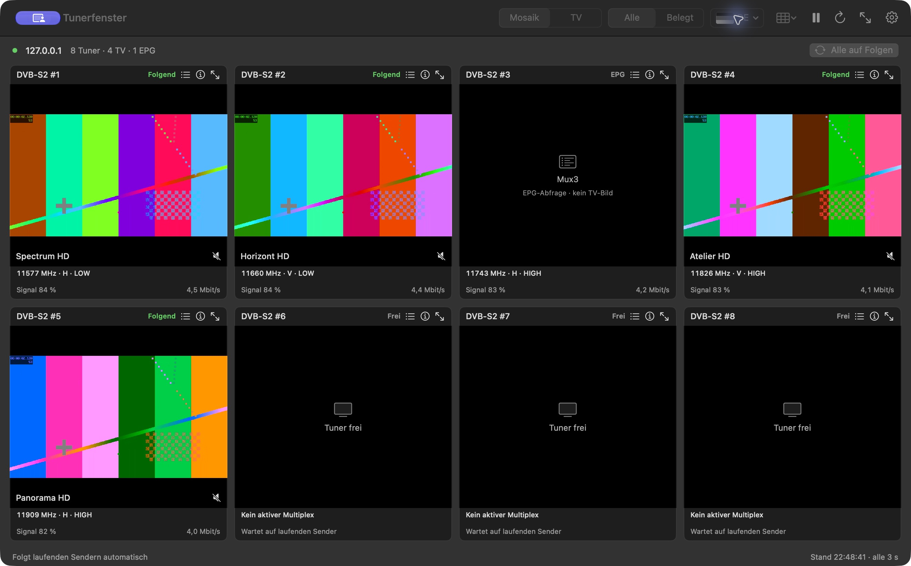
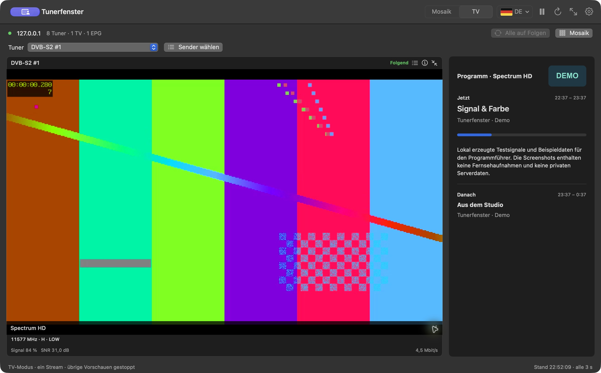
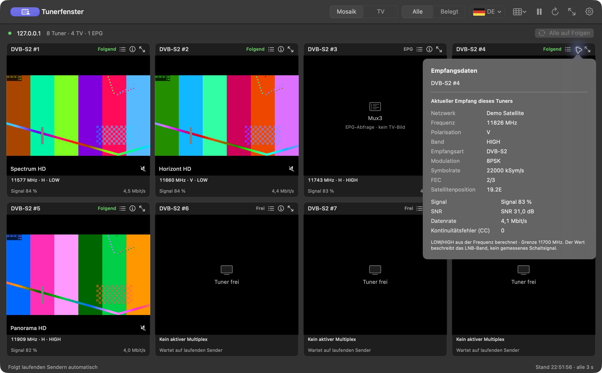

# Tunerfenster

[English](README.md) · [Deutsch](README.de.md)


Tunerfenster ist eine native macOS-App für TVHeadend-Streams. Du kannst alle
Tuner als Mosaik anzeigen, einen Sender mit Programmführer und Logo ansehen
oder Aufzeichnungen vom Server abspielen.

## Download

Benötigt macOS 14 oder neuer. VLC ist enthalten.

| Dein Mac | Signierte und notarisierte Installationsdatei |
| --- | --- |
| Apple Silicon (M1 oder neuer) | [arm64-DMG herunterladen](https://github.com/NemoN/Tunerfenster/releases/latest/download/Tunerfenster-2.0-arm64.dmg) |
| Intel (64 Bit) | [x64-DMG herunterladen](https://github.com/NemoN/Tunerfenster/releases/latest/download/Tunerfenster-2.0-x86_64.dmg) |

[Alle Releases und SHA-256-Prüfsummen](https://github.com/NemoN/Tunerfenster/releases)

1. Die DMG öffnen und **Tunerfenster** in **Applications / Programme** ziehen.
2. Die App starten und **Tunerfenster → Einstellungen** öffnen.
3. TVHeadend-Adresse, Benutzername und Passwort eingeben und verbinden.

Deine Einstellungen bleiben bei Updates erhalten. Die App startet stumm.

## Screenshots

Die Screenshots zeigen Tunerfenster 1.9.0 an einem echten TVHeadend-Server.
Die Fensterkopfzeile mit der privaten Serveradresse ist aus den Bildern
herausgeschnitten.

### Live-TV mit EPG und Empfangsdaten


### Aufnahmen abspielen


### VLC-Streamstatistik


### Tuner-Mosaik

13 Tuner mit einem Live-Stream, einer EPG-Abfrage und freien Tunern.


<details>
<summary>Demo-Screenshots auf Deutsch und Englisch</summary>

Die folgenden Beispiele verwenden erfundene Sender und erzeugte Testsignale.

### Tuner-Mosaik



### TV-Modus mit EPG und Senderlogo



### Empfangsdaten



</details>

## Funktionen

### Live-TV

In den Einstellungen kannst du mehrere TVHeadend-Server hinterlegen. Das
Mosaik gruppiert ihre Tuner nach Server; für TV und Aufnahmen wählst du den Server
oben links. Senderzuordnungen werden pro Server gespeichert.

Im TV-Modus läuft der gewählte Tuner, die übrigen Streams stoppen. Der
Programmführer zeigt die laufende und
die nächste Sendung mit Beschreibung und Fortschritt. TVHeadend-Senderlogos,
auch SRP-Picons, stehen in der vergrößerten Ansicht neben dem Sendernamen.
Im Mosaik und im TV-Modus zeigt ein roter ausgefüllter Kreis hinter dem
Tunernamen eine laufende Aufnahme auf diesem TVHeadend-Eingang an.

**Folgen** zeigt Sender, die bereits auf dem Server laufen. Freie Tuner und
EPG-Abfragen haben eigene Statusanzeigen. Um selbst einen Sender zu wählen,
öffne die Senderliste einer Kachel. Sie öffnet sich beim aktuellen Sender;
ein Doppelklick oder **Sender wechseln** schaltet um. **Alle auf Folgen** setzt
die manuellen Zuordnungen zurück.

Die Kachel bleibt an ihrem Platz, wenn TVHeadend einen anderen Tuner nutzt.
Ist die Zuordnung eindeutig, tauschen die Kopfzeilen ihre Beschriftungen und
zeigen die tatsächlichen Tuner. Eine folgende Kachel spielt denselben
manuellen Stream vom gleichen Eingang nicht noch einmal ab.

In der Einzelansicht wechselst du den Sender mit den Pfeilbuttons oder
**Sender wählen**. Diese stehen vor **Alle belegen**. Unter dem EPG findest du
Frequenz, V/H, LOW/HIGH, Empfangsart, Modulation, Symbolrate, FEC,
Satellitenposition, Signal, SNR, Datenrate und CC-Fehler, soweit TVHeadend sie
liefert. Das Statistiksymbol über dem Video blendet VLCs Eingangs-, Demux-,
Video- und Audiozähler ins Bild ein. Die Werte werden jede Sekunde aktualisiert.

Im TV-Modus kannst du den Punkt zwischen EPG und Empfangsdaten ziehen, um die
Bereiche zu vergrößern oder zu verkleinern. Ein höherer Empfangsbereich zeigt
weitere technische Daten; du kannst darin auch scrollen. Die Aufteilung wird
gespeichert.

**Aufnehmen** im EPG des TV-Modus startet eine Aufnahme auf TVHeadend. Dein
Benutzer braucht Aufnahmerechte und ein aktives Aufnahmeprofil. Das EPG-Ende
und der Nachlauf des Profils bestimmen, wann sie endet. Der Programmführer
zeigt auch vorhandene Aufnahmen. Während der Aufnahme pulsiert der rote
Button. **Aufnahme stoppen** beendet sie und behält die bisherige Datei.
Die bisherige Aufnahmedauer steht neben dem Stoppbutton als Stunden:Minuten:Sekunden.

### Aufnahmen

Die Liste zeigt abgeschlossene und laufende Aufnahmen von TVHeadend. Du kannst
nach Titel, Sender oder Ordnername suchen. Ein Klick zeigt die Sendungsinfos.
Ein Doppelklick, **Aufnahme abspielen** oder **⌘P** startet die Wiedergabe mit
Ton an der gespeicherten Position. Der Player hat Pause, Zeitleiste und
Tonsteuerung. Wenn du eine andere Aufnahme auswählst, stoppt die Wiedergabe.
Die App zeigt die neuen Infos, ohne die Aufnahme zu starten. Beim Wechsel zu
Aufnahmen stoppen die Live-Streams der App; deine Senderzuordnungen bleiben
gespeichert.

Comskip-Werbemarkierungen erscheinen als orange Abschnitte in der Zeitleiste,
auch im Vollbild. In den Einstellungen kannst du das automatische Überspringen
einschalten. Jeder Block wird pro Wiedergabe einmal übersprungen. Wenn du
zurückspulst, kannst du ihn ansehen. Die Aufnahmedatei bleibt unverändert.

TVHeadend liest Comskip-Dateien (`.txt`) und EDL-Dateien (`.edl`) neben der Aufnahme.
Tunerfenster lädt diese Markierungen über HTSP mit deinen vorhandenen Zugangsdaten.
HTSP verwendet normalerweise Port 9982 auf dem TVHeadend-Server. Server und Port
lassen sich unter **Einstellungen → Werbemarkierungen** ändern. Comskip muss bereits
auf dem Server eingerichtet sein. Die Markierungen werden beim Auswählen einer
Aufnahme geprüft. Fehlende Markierungen oder ein HTSP-Fehler verhindern die
Wiedergabe nicht.

Ziehe die Trennlinie neben dem Player, um die Liste breiter oder schmaler zu
machen. Die Trennlinie über den Sendungsinfos gibt dem Text mehr Platz und
verkleinert das Video. Die App speichert beide Positionen und die aufgeklappten
Ordner.

#### Ordner, Titel und Sortierung

Serverordner erscheinen als aufklappbare Gruppen mit Aufnahmezahl und
Unterordnern. Aufnahmen im Hauptverzeichnis oder allein in einem Ordner stehen
direkt in der Liste. Beim Verweilen über einer Aufnahme siehst du ihren Pfad.
**Aktualisieren (⌘R)** übernimmt auf dem Server verschobene Aufnahmen.

Die App kann einen Folgennamen aus dem Untertitel oder einem ausdrücklich
benannten Episodenfeld in der Beschreibung ergänzen, etwa "Tatort: Charlie".
Das gilt für alle Serien und Sendungen. Vollständige Titel bleiben erhalten;
wiederholte Namen und reine Genreangaben werden nicht angehängt. Bei
uneindeutigen Metadaten bleibt der Originaltitel stehen. Nur der angezeigte
Name ändert sich; Einträge und Dateien auf dem Server bleiben erhalten.
Innerhalb eines Ordners entfällt dessen Name am Anfang des Titels:
"Tatort: Charlie" steht unter "Tatort" als "Charlie". Suche und Player zeigen
den vollständigen Titel.

Jede Zeile zeigt Gesehen-Status, Titel, Sender, Datum und Dauer, rechts steht
Löschen. Die Spalten haben kleine Abstände und ausgerichtete Datumsangaben mit
führenden Nullen. Die Dauer steht hinter dem Datum, mit Uhrsymbol und im
Format Stunden:Minuten:Sekunden. Sie stammt aus der Planung von TVHeadend und
kann von der Dateilänge abweichen. Ein Strich bedeutet, dass die Angabe fehlt.
Wird die Liste schmaler, verschwinden zuerst Sender und Datum, danach die
Dauer. Das gilt bei derselben Listenbreite für alle Zeilen, auch in Ordnern
und Suchergebnissen.

Die Symbole für Name, Datum und Dauer neben der Gesamtzahl sortieren die
Liste. Ein weiterer Klick auf das aktive Symbol kehrt die Reihenfolge um.
Ordner und einzelne Aufnahmen werden gemeinsam einsortiert, auch innerhalb
von Ordnern. Für Ordner zählt beim Datum die neueste Aufnahme, bei der Dauer
die längste, jeweils einschließlich der Unterordner. Fehlende Dauerangaben
stehen in beiden Richtungen am Ende. Die App speichert die Sortierung.

#### Gesehen-Status und Löschen

Ein leerer Kreis vor dem Titel steht für ungesehen, ein halb gefüllter Kreis
für angefangen und ein Auge für gesehen. Der Tooltip zeigt die
Fortsetzungsposition. Ein roter ausgefüllter Punkt hinter dem Titel markiert
eine laufende Aufnahme. Ein Warnsymbol an dieser Stelle weist auf Fehler oder
eine fehlende Datei hin; die Details stehen im Tooltip. Mit Abspielen im
Player oder Kontextmenü startest du die Wiedergabe.

Die Wiedergabe setzt an der gespeicherten Stelle fort. **Von Anfang an
abspielen** im Player oder Kontextmenü startet neu. Kann VLC die Dateidauer
nicht ermitteln, verwendet der Player die ungefähre Dauer aus TVHeadend und
markiert sie mit **≈**.

Die App synchronisiert den Fortschritt alle zehn Sekunden mit TVHeadend,
außerdem beim Pausieren, nach dem Spulen, beim Aufnahme- oder Moduswechsel und
beim Beenden. Fehlgeschlagene Übertragungen bleiben lokal für den jeweiligen
Server und Benutzer gespeichert und werden erneut versucht. Ab 90 % oder am
Wiedergabeende wird eine abgeschlossene Aufnahme als gesehen markiert und die
Fortsetzungsposition gelöscht. Vorhandene Gesehen-Markierungen bleiben
erhalten.

Im Kontextmenü kannst du **Als gesehen markieren** oder **Als ungesehen
markieren** wählen. Beides löscht die Fortsetzungsposition und synchronisiert
den gewählten Status mit TVHeadend. Bei pausierter Wiedergabe bleibt die
Auswahl bestehen, bis du weiterschaust. Status und Position gehören zum
Servereintrag; andere Clients können sie ebenfalls lesen oder ändern.

Abgeschlossene Aufnahmen löschst du über den Papierkorb oder das Kontextmenü.
Die Bestätigung nennt die Aufnahme. Wenn du bestätigst, werden Datei und
Eintrag dauerhaft von TVHeadend gelöscht. Laufende Aufnahmen musst du vorher
beenden.

### Bedienung und Einstellungen

Beim Vergrößern einer Live-Kachel schaltet sich ihr Ton ein. Die Rückkehr ins
Mosaik schaltet ihn stumm. Du kannst den Ton auch manuell oder mit **M**
umschalten. Sind im Mosaik alle Streams stumm, schaltet **M** den Ton des
ersten aktiven Streams ein.

- **⌘1**, **⌘2**, **⌘3**: zu Mosaik, TV oder Aufnahmen wechseln.
- **↑ / ↓** oder die Pfeilbuttons: in der vergrößerten Ansicht den Sender in
  Listenreihenfolge wechseln. Nach dem letzten folgt wieder der erste,
  rückwärts nach dem ersten der letzte.
- **⌘P**: die ausgewählte Aufnahme starten, während der Wiedergabe pausieren
  oder fortsetzen.
- **M**: Ton stumm oder wieder einschalten.
- Ein Doppelklick ins Video schaltet Vollbild ein oder aus. **Esc** oder
  **⌃⌘F** beendet Vollbild ebenfalls. In der vergrößerten Live-Ansicht führt
  ein weiteres **Esc** zurück ins Mosaik.

Im Vollbild erscheint die Steuerung bei Mausbewegung und verschwindet nach
drei Sekunden Ruhe. Bei Aufnahmen zeigt sie auch die Zeitleiste. Solange du
den Regler ziehst, bleibt sie sichtbar.

Die App speichert manuelle Sender, Modus und gewählten TV-Tuner für jeden
Server und Benutzer, auch über vorübergehende Ausfälle hinweg. Du kannst
Deutsch oder Englisch für Menüs, Einstellungen und Statusmeldungen wählen.
Das Darstellungssymbol vor den Einstellungen wechselt zwischen **System
folgen**, **Hell** und **Dunkel** und speichert die Auswahl.

Die Titelzeile zeigt die installierte Version. Das Abfrageintervall für den
Tunerstatus stellst du in den Einstellungen oder rechts unten im Fenster auf
1 bis 60 Sekunden ein. Die App speichert es automatisch. Die Wiedergabe nutzt
VLCKit 3.7.4 / libVLC 3.0.24; es gibt getrennte Builds für Apple Silicon und
Intel.

## Softwareupdates

Während die App läuft, prüft sie GitHub einmal täglich auf eine neuere stabile
Version. Ist eine verfügbar, findest du über **Update ansehen** den passenden
Download für deinen Mac. Apple Silicon wird auch erkannt, wenn die
Intel-Version unter Rosetta läuft.

Über **Tunerfenster → Nach Updates suchen …** prüfst du manuell. Die
automatische Prüfung lässt sich in den Einstellungen oder im Fenster
Softwareupdates abschalten.

Bei Releases mit signiertem Update-Feed öffnet **Update installieren …** die
Installation. Sparkle lädt und prüft das Update. Wenn du bestätigst, ersetzt
es die App und startet sie neu. Deine Einstellungen bleiben erhalten. Die
bisher veröffentlichten Versionen bis 2.0 brauchen einmal ein manuelles Update,
um diese Installation zu bekommen. Releases ohne signierten Feed bieten weiter
die DMG an: im Browser laden, Tunerfenster beenden und die App ersetzen.

Die Versionszeile zeigt die Architektur der laufenden App. Läuft eine
Intel-Version über Rosetta, erklärt das Fenster, dass das Update die native
Version für Apple Silicon installiert. Die Update-Prüfung sendet keine
TVHeadend-Adresse, Zugangsdaten oder Tunerdaten an GitHub.

## Arbeitsweise

Tunerfenster liest TVHeadends Status-, Service-, Sender- und EPG-APIs und
öffnet HTTP-Streams mit niedriger Priorität und kurzlebigen Wiedergabetickets.
Im Folgen-Modus endet ein Stream, wenn der externe Zuschauer den Sender
verlässt. Im TV-Modus stoppen die übrigen Streams. Tuner-, Sender- und
Aufnahmeeinstellungen bleiben wie auf dem Server festgelegt.

TVHeadend wählt den physischen Tuner. Die manuelle Senderwahl legt den Service
für eine Kachel fest; über die HTTP-API kann die App keinen bestimmten
Hardware-Eingang dafür reservieren.

LOW/HIGH wird aus der gemeldeten Frequenz berechnet. Die Grenze liegt
standardmäßig bei 11700 MHz und lässt sich in den Einstellungen ändern. Der
Wert misst nicht den DiSEqC- oder 22-kHz-Schaltzustand.

## Serverzugriff und Datenschutz

Dein TVHeadend-Benutzer braucht Streamingrechte und Zugriff auf die Status-
und Katalog-APIs. Je nach Serverkonfiguration benötigen Service-Streams auch
**Advanced streaming** und Statusabfragen Administratorrechte. Tunerfenster
unterstützt Digest, Basic und Verbindungen ohne Anmeldung.

Für Aufnahmen ist zusätzlich **Video Recorder → Basic** nötig. TVHeadend
speichert die Aufnahmen auf dem Server und nimmt weiter auf, wenn du den
Sender wechselst oder Tunerfenster beendest.

Passwörter liegen im macOS-Schlüsselbund. Die gespeicherten Sender- und
Ansichtseinstellungen enthalten Service-IDs und Tunernamen, aber keine
Passwörter oder Wiedergabetickets. Die Verbindung richtest du direkt in der
App ein; ein MCP-Server ist dafür nicht nötig.

## Selbst bauen

Du brauchst Xcode oder geeignete macOS-Entwicklerwerkzeuge mit Swift 5.9 oder
neuer. Die DMG-Skripte benötigen die `diskutil image`-Befehle von macOS 27.

```bash
git clone https://github.com/NemoN/Tunerfenster.git
cd Tunerfenster
chmod +x ./*.sh scripts/*.sh
./build-app.sh --no-bootstrap
open dist/Tunerfenster.app
```

Der Build lädt das offizielle VideoLAN-Framework in der festgelegten Version,
prüft seine SHA-256-Prüfsumme und bündelt den Code für die gewählte
CPU-Architektur. Git ignoriert Build-Ausgaben und Download-Cache.

Lokale Builds werden ad hoc signiert, sofern du kein festes Zertifikat
hinterlegt hast. Mit demselben Zertifikat bleibt der Schlüsselbundzugriff
über mehrere Builds erhalten. Die [Einrichtung steht in der Bauanleitung](docs/BUILDING.md#local-build).

[Bauen, Testen und notarisierte Releases](docs/BUILDING.md) beschreibt die
Architekturauswahl, Developer-ID-Signierung und die Befehle zum Nachbauen eines
Releases.

## Drittanbieter-Software

Für den Tunerfenster-Quellcode ist noch keine Lizenz festgelegt.
Drittanbieter-Komponenten behalten ihre eigenen Lizenzen.

VLCKit / libVLC stammt von VideoLAN und Mitwirkenden und steht unter LGPL 2.1
oder neuer. Die App enthält den Lizenztext, Quellcode-Verweise und eine Anleitung
zum Austausch des Frameworks. Siehe [Drittanbieter-Hinweise](Resources/ThirdPartyNotices.txt).
Tunerfenster lädt das Framework dynamisch. Für den lokalen Einsatz kannst du es
durch eine kompatible, geänderte Version ersetzen.

Sparkle übernimmt Updates in der App. Seine Lizenz und die enthaltenen
Drittanbieter-Hinweise liegen als Sparkle-LICENSE.txt in der App bei.
