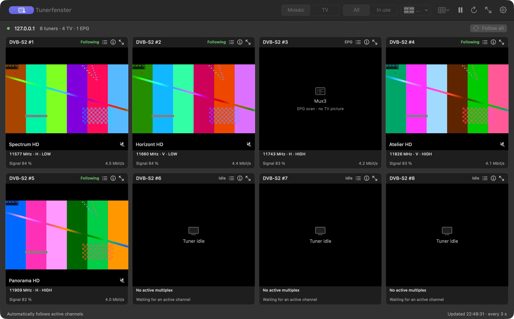
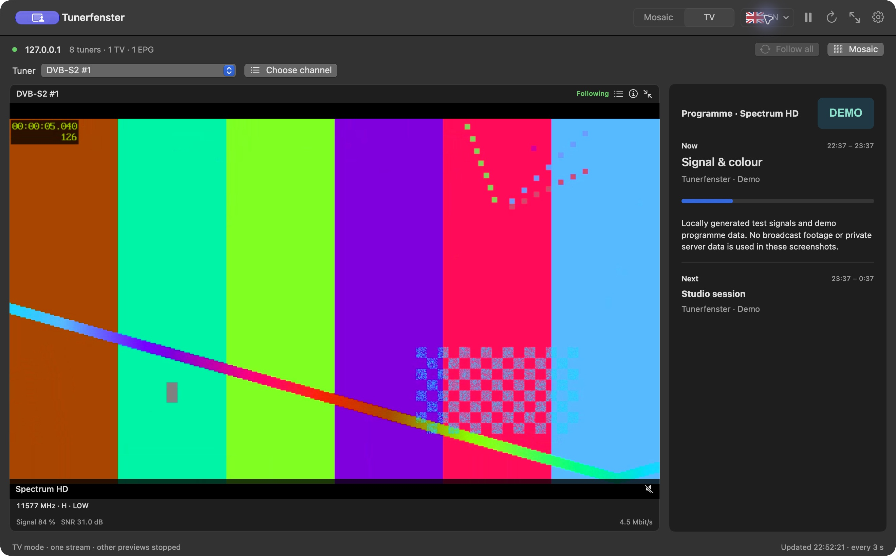

# Tunerfenster

[English](README.md) · [Deutsch](README.de.md)


A native macOS viewer for TVHeadend. Watch your tuners together in a mosaic or
switch to a single-channel TV view with a programme guide and channel logo.
The VLC playback engine is included.

## Download

**macOS 14 or later. No separate VLC installation required.**

| Your Mac | Signed and notarized installer |
| --- | --- |
| Apple Silicon — M1 or newer | [Download arm64 DMG](https://github.com/NemoN/Tunerfenster/releases/latest/download/Tunerfenster-1.7.1-arm64.dmg) |
| Intel — 64-bit | [Download x64 DMG](https://github.com/NemoN/Tunerfenster/releases/latest/download/Tunerfenster-1.7.1-x86_64.dmg) |

[All releases and SHA-256 checksums](https://github.com/NemoN/Tunerfenster/releases)

1. Open the DMG and drag **Tunerfenster** into **Applications**.
2. Start the app and open **Tunerfenster → Settings**.
3. Enter your TVHeadend URL, username and password, then connect.

Existing settings survive an update. Every launch starts muted.

## Screenshots

Screenshots use a local demo server, fictitious channels and generated test
signals. They contain no broadcast footage or private server configuration.

### Tuner mosaic



### TV mode with EPG and channel picon



### German interface and reception details


## Features

- **Mosaic and TV modes:** fit all tuners into the window, or play only the
  selected tuner preview with current/next EPG, description and progress.
- **Follow active tuners:** automatically show services already running on the
  server. Idle tuners and EPG scans have distinct states.
- **Manual channel selection:** choose a channel for any tile and return all
  manual assignments to following with one button.
- **Reception information:** frequency, V/H, LOW/HIGH, delivery system,
  modulation, symbol rate, FEC, orbital position, signal, SNR and continuity
  errors, when supplied by TVHeadend.
- **Channel logos:** use the picons configured in TVHeadend, including SRP
  picons, beside the channel name in the enlarged view.
- **Focused audio:** enlarge a tile to hear its audio; return to the mosaic to
  mute it. Manual mute remains available.
- **Saved choices:** restore manual channels, viewing mode and the selected
  TV tuner per server/account, including after temporary outages.
- **English and German:** switch language inside the app; menus, settings and
  status messages follow the selection.
- **Self-contained playback:** bundled VLCKit 3.7.4 / libVLC 3.0.24, with
  separate Apple Silicon and Intel builds.

## How it works

Tunerfenster reads TVHeadend's status, service, channel and EPG APIs and opens
low-priority HTTP previews using short-lived playback tickets. Automatic tiles
stop when the external viewing session ends. TV mode stops the other previews.
The app does not modify tuner, channel or recording configuration.

**A tile is not a hardware reservation.** TVHeadend chooses the physical tuner
used for a preview. A manual choice selects a service for that tile; it cannot
pin the stream to a particular physical input through the HTTP API.

LOW/HIGH is calculated from the reported frequency, with an adjustable
11700 MHz default boundary. It is not a measured DiSEqC or 22 kHz state.

## Server access and privacy

The TVHeadend account needs access to the relevant status/catalog APIs and
streaming permissions. Direct service previews may require **Advanced
streaming**; status queries may require administrator access, depending on
the server configuration. Digest, Basic and unauthenticated access are supported.

Passwords are stored in macOS Keychain. Saved channel and viewing preferences
contain service IDs and tuner names, not passwords or playback tickets.
No MCP server is required. Connection details are entered directly in the app.

## Build from source

Requires Xcode or compatible macOS command-line build tools with Swift 5.9 or
newer. The DMG packaging scripts use the macOS 27 `diskutil image` commands.

```bash
git clone https://github.com/NemoN/Tunerfenster.git
cd Tunerfenster
chmod +x ./*.sh scripts/*.sh
SIGN_IDENTITY=- ./build-app.sh
open dist/Tunerfenster.app
```

The build downloads the pinned official VideoLAN framework, verifies its
SHA-256 checksum and embeds the matching CPU slice. Build outputs and the
download cache are ignored by Git.

See [building, testing and notarized releases](docs/BUILDING.md) for architecture
selection, Developer ID signing and reproducible release commands.

## Third-party software

No license has been specified for the Tunerfenster source code yet.
The third-party components retain their own licenses.

VLCKit / libVLC is provided by VideoLAN and its contributors under **LGPL 2.1
or later**. Its license text, source references and replacement instructions
are included in the app. See [third-party notices](Resources/ThirdPartyNotices.txt).
The framework remains dynamically loaded and can be replaced with a compatible
modified build for local use.
