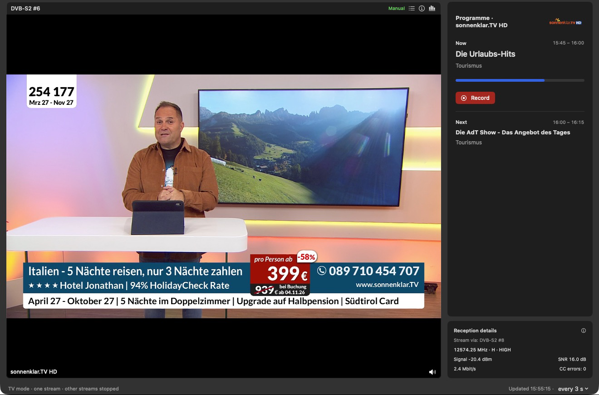
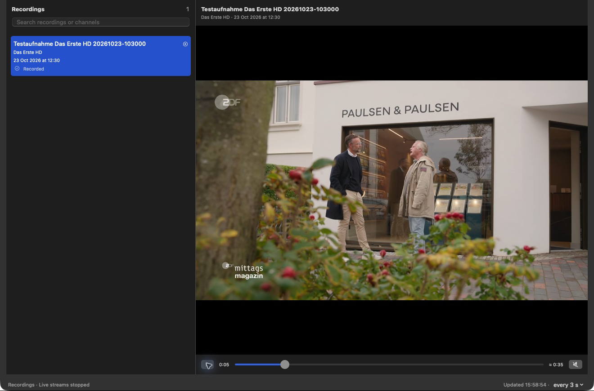
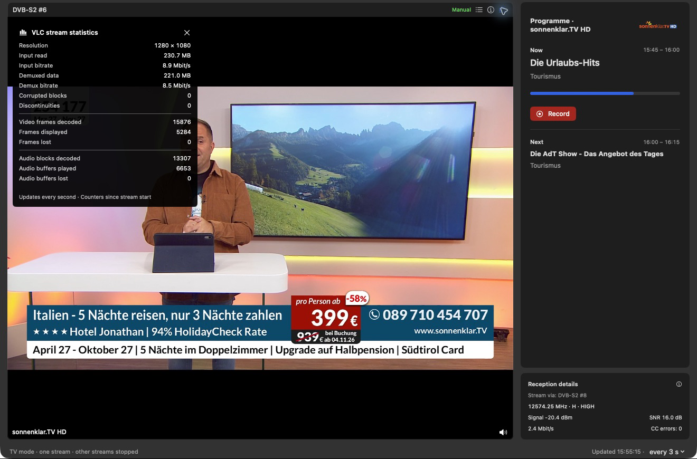
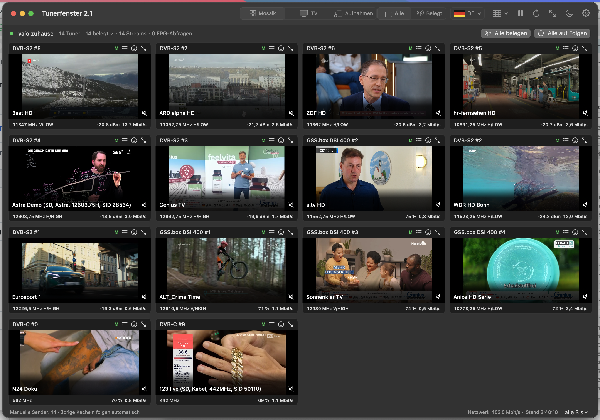

# Tunerfenster

[English](README.md) · [Deutsch](README.de.md)


Tunerfenster is a native macOS app for watching TVHeadend streams. Show your
tuners in a mosaic, watch one channel with its programme guide, or play
recordings stored on the server.

## Download

Requires macOS 14 or later. VLC is included.

Download the signed installer from the [latest release](https://github.com/NemoN/Tunerfenster/releases/latest).
Choose the `arm64` DMG for Apple Silicon or the `x86_64` DMG for Intel Macs.

[All releases and SHA-256 checksums](https://github.com/NemoN/Tunerfenster/releases)

1. Open the DMG and drag **Tunerfenster** into **Applications**.
2. Start the app and open **Tunerfenster → Settings**.
3. Enter your TVHeadend URL, username and password, then click **Save**.

Updates keep your settings. The app starts muted.

## Screenshots

Tunerfenster connected to a TVHeadend server:

### Live TV with EPG and reception details



### Recording playback



### VLC stream statistics



### Tuner mosaic



## Features

### Live TV

You can save multiple TVHeadend servers in Settings. Mosaic groups the tuners
by server; choose the server at the top left for TV and recordings. Channel
assignments are saved separately for each server.

TV mode plays the selected tuner and stops the other streams. The programme
guide shows the current and next
programmes, their descriptions and programme progress. TVHeadend picons,
including SRP picons, appear beside the channel name in the enlarged view.
In Mosaic and TV mode, a filled red circle after the tuner name marks an active
recording on that TVHeadend input.

Follow mode shows channels already running on the server. Idle tuners and EPG
scans have their own labels. To choose a channel yourself, open the selector
for a tile. It opens at the current channel; double-click a row or click
**Switch channel** to tune it. **Follow all** clears the manual assignments.

The tile stays in place when TVHeadend picks another tuner. If the mapping is
unambiguous, the headers swap to show the actual tuners. A following tile does
not repeat a manual stream from the same input.

Use the up/down buttons or **Choose channel** to change channels in the
single-channel view. These controls sit before **Use all tuners**. Below the
programme guide, reception details show frequency, V/H, LOW/HIGH, delivery
system, modulation, symbol rate, FEC, orbital position, signal, SNR, bitrate
and continuity errors, where TVHeadend supplies them. The statistics button
above the video opens VLC's input, demux, video and audio counters over the
picture, with new values every second.

In TV mode, drag the dot between the programme guide and reception details to
resize the two panels. A taller reception panel reveals more technical data;
you can also scroll through it. The panel sizes are saved.

In the TV programme guide, **Record** starts a recording on TVHeadend. Your
account needs recording permission and an active recording profile. The EPG
end time plus the profile's extra recording time determines when it stops.
The guide also shows existing recordings. The red button pulses while
recording; **Stop recording** ends it and keeps the file recorded so far.
The elapsed recording time appears next to the stop button as hours:minutes:seconds.

### Recordings

The list shows completed and ongoing recordings from TVHeadend. Search by
title, channel or folder name. Click a recording to read its programme
information. Double-click it, choose **Play recording** or press **⌘P** to play
from the saved position with audio. The player has pause, seeking and mute
controls. Selecting another recording stops playback and shows its information
without starting it. Switching to Recordings stops the app's live streams and
keeps your channel assignments.

Comskip commercial markers appear as orange sections on the timeline, in the
window and in full screen. You can turn on automatic skipping in Settings.
Each break is skipped once per playback; seeking back lets you watch it.
The recording file is unchanged.

TVHeadend reads Comskip `.txt` and EDL `.edl` files beside the recording. Tunerfenster
fetches these markers through HTSP using your existing credentials. HTSP normally
uses port 9982 on the TVHeadend server; change the host or port under
**Settings → Commercial markers** if needed. Comskip must already be configured
on the server. Markers are checked when you select a recording. Missing markers
or an HTSP error do not prevent playback.

Drag the divider beside the player to change the list width. Drag the divider
above the programme information to give the text more space and make the video
smaller. The app saves both divider positions and the expanded folders.

#### Folders, titles and sorting

Server folders appear as expandable groups with recording counts and
subfolders. Recordings in the storage root or alone in a folder appear directly
in the list. Hover over a recording to see its path. **Refresh (⌘R)** picks up
recordings moved on the server.

#### Viewing status and deletion

An empty circle before the title means unwatched, a half-filled circle means
partly watched, and an eye means watched. Hover over the symbol to see the
resume time. A filled red dot after the title marks a recording still in
progress. A warning symbol there marks errors or an unavailable file; hover
for details. Use Play in the player or context menu to start playback.

Playback resumes from the saved position. **Play from beginning** in the player
or context menu starts over. If VLC cannot determine the file duration, the
player uses TVHeadend's approximate duration and marks it **≈**.

The app syncs progress with TVHeadend every ten seconds, when paused, after
seeking, when changing recordings or modes, and on quit. Failed updates stay
saved locally for that server and account and are retried. At 90% or playback
end, a completed recording is marked watched and its resume position is
cleared. Existing watched marks are kept.

The context menu has **Mark as watched** and **Mark as unwatched**. Both clear
the resume position and sync the chosen status with TVHeadend. If playback is
paused, that choice stays until you continue watching. Watched status and
resume points belong to the server entry, so other clients can read or change
them too.

To delete a completed recording, use the trash button or context menu. The
confirmation names the recording. Confirming permanently deletes its file and
entry from TVHeadend. Stop a running recording before deleting it.

### Controls and preferences

Enlarging a live tile turns on its audio; returning to Mosaic mutes it. You
can mute it manually or press **M**. If every stream in Mosaic is muted,
**M** unmutes the first active one.

- **⌘1**, **⌘2**, **⌘3**: switch to Mosaic, TV or Recordings.
- **↑ / ↓** or the arrow buttons: change channels in the enlarged view, in
  list order, wrapping at either end.
- **⌘P**: start the selected recording, or pause/resume during playback.
- **M**: mute or unmute.
- Double-click the video to enter or leave full screen. **Esc** or **⌃⌘F**
  also leaves full screen. In the enlarged live view, a second **Esc** returns
  to Mosaic.

In full screen, mouse movement shows playback controls. They hide after three
seconds of inactivity. Recordings also show the timeline; dragging the playhead
keeps the controls visible.

The app saves manual channels, viewing mode and the selected TV tuner for each
server and account, including across temporary outages. Choose English or
German for menus, settings and status messages. The appearance icon before
Settings cycles through **Follow system**, **Light** and **Dark** and saves
your choice.

The title bar shows the installed version. Set the status refresh interval
from 1 to 60 seconds in Settings or at the bottom right of the window; the app
saves it automatically. Playback uses VLCKit 3.7.4 / libVLC 3.0.24, with separate
builds for Apple Silicon and Intel.

## Software updates

While running, Tunerfenster checks GitHub once a day for a newer stable release.
When an update is available, **View update** shows the download for your Mac.
Apple Silicon is detected even when the Intel app runs under Rosetta.

Use **Tunerfenster → Check for Updates…** to check manually. You can turn off
automatic checks in Settings or the Software Updates window.

For releases with a signed update feed, **Install update…** opens the installer.
Sparkle downloads and verifies the update, then replaces and restarts the app
when you confirm. Your settings are kept.

The installed version line shows the architecture of the running app. If an
Intel build runs under Rosetta, the window explains that the update will install
the native Apple Silicon build. Update checks send no TVHeadend address,
credentials or tuner information to GitHub.

## How it works

Tunerfenster reads TVHeadend's status, service, channel and EPG APIs and opens
HTTP streams with low priority and short-lived playback tickets. In Follow
mode, a stream stops when the external viewer leaves the channel. TV mode
stops the other streams. Tuner, channel and recording configuration stays as
set on the server.

TVHeadend chooses the physical tuner. A manual channel selection sets the
service for a tile; the HTTP API cannot reserve a specific hardware input for
that stream.

LOW/HIGH is calculated from the reported frequency. The threshold defaults to
11700 MHz and can be changed in Settings. It does not measure the DiSEqC or
22 kHz switching state.

## Server access and privacy

Your TVHeadend account needs streaming permission and access to the status and
catalog APIs. Depending on the server setup, service streams may also need
**Advanced streaming** permission and status queries may need administrator
access. Tunerfenster supports Digest, Basic and connections without
authentication.

Recording also needs TVHeadend's **Video Recorder → Basic** permission.
TVHeadend stores the recordings and keeps recording if you change channels or
quit Tunerfenster.

Passwords are stored in macOS Keychain. Saved channel and viewing preferences
contain service IDs and tuner names, with no passwords or playback tickets.
Enter your connection details in the app; an MCP server is not required.

## Build from source

You need Xcode or compatible macOS command-line tools with Swift 5.9 or newer.
The DMG scripts require the macOS 27 `diskutil image` commands.

```bash
git clone https://github.com/NemoN/Tunerfenster.git
cd Tunerfenster
chmod +x ./*.sh scripts/*.sh
./build-app.sh --no-bootstrap
open dist/Tunerfenster.app
```

The build downloads the pinned official VideoLAN framework, checks its SHA-256
checksum and bundles the code for the selected CPU architecture. Build outputs
and the download cache are ignored by Git.

Local builds use ad-hoc signing unless you pin a certificate. Using the same
certificate keeps Keychain access across rebuilds; see the
[local signing setup](docs/BUILDING.md#local-build).

[Building, testing and notarized releases](docs/BUILDING.md) covers architecture
selection, Developer ID signing and the commands to reproduce a release.

## Third-party software

No license has been chosen for Tunerfenster's source code. Third-party
components retain their own licenses.

VLCKit / libVLC is provided by VideoLAN and its contributors under LGPL 2.1 or
later. The app includes the license, source references and instructions for
replacing the framework. See [third-party notices](Resources/ThirdPartyNotices.txt).
Tunerfenster loads the framework dynamically, so a compatible modified build
can replace it for local use.

Sparkle handles in-app updates. Its license and bundled third-party notices
are included in Sparkle-LICENSE.txt in the app.
